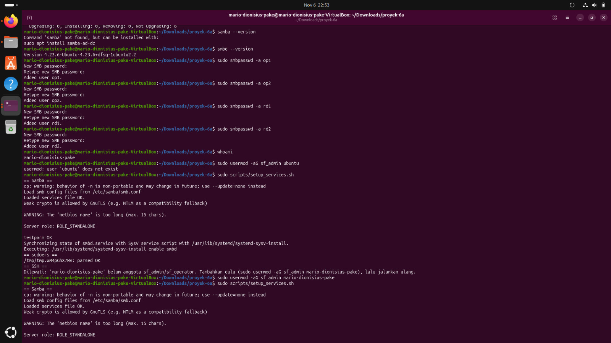
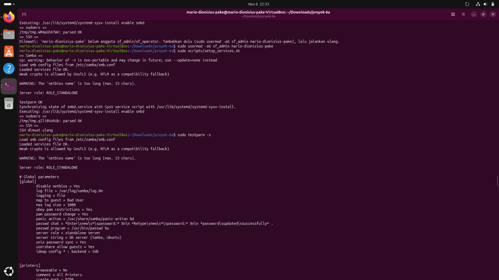
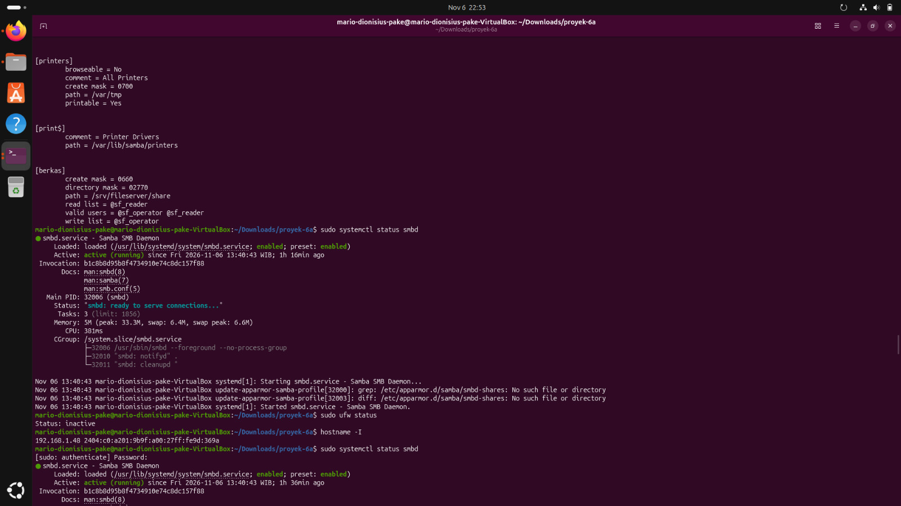

# Bukti Pekerjaan: Samba Server

**Penanggung jawab:** Zahara Marchela (2510512200), Kelas E / Kelompok 02
**Tanggal pengerjaan:** 6 November 2026

## 1. Instalasi dan konfigurasi Samba

- Paket Samba terpasang di Ubuntu. Versi dicek dengan `smbd --version`: Samba 4.23.6-Ubuntu-4.23.6+dfsg-1ubuntu2.2.
- Konfigurasi diterapkan dengan `sudo scripts/setup_services.sh`. Skrip ini menulis `/etc/samba/smb.conf`, menjalankan `testparm`, dan mengaktifkan layanan `smbd`.
- `testparm` menampilkan "Loaded services file OK" dan "testparm OK" (server role: ROLE_STANDALONE).
- Layanan `smbd` berstatus active (running) dan enabled, dengan pesan "smbd: ready to serve connections...".

Bukti:

## 2. Pembuatan shared folder

- Nama share: `[berkas]`
- Path: `/srv/fileserver/share`
- `create mask = 0660` dan `directory mask = 02770`

Bukti:

## 3. Pengaturan hak akses Samba

| Pengaturan | Nilai |
|---|---|
| `valid users` | `@sf_operator @sf_reader` |
| `write list` | `@sf_operator` (baca-tulis) |
| `read list` | `@sf_reader` (hanya baca) |

- User Samba didaftarkan dengan `sudo smbpasswd -a`: `op1`, `op2`, `rd1`, `rd2`.
- Grup administrator `sf_admin`: user ditambahkan dengan `sudo usermod -aG sf_admin <user>`.

Bukti: lihat `03_shared_folder_dan_hak_akses.jpeg` (konfigurasi share) dan `01_instalasi_dan_user_samba.jpeg` (pendaftaran user).
